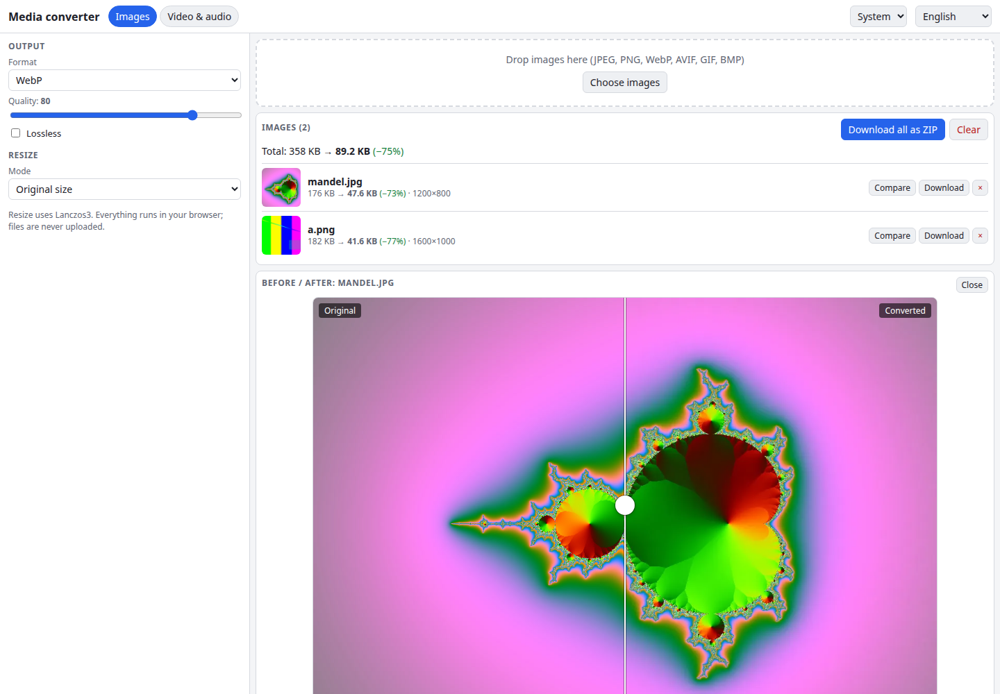

# Media Converter

Resize, compress and convert images, video and audio without uploading anything. Images go through the Squoosh codecs (MozJPEG, WebP, AVIF, OxiPNG) via jSquash; video and audio go through FFmpeg.wasm. Everything runs locally in your browser.

**Try it: [hermes98761234.github.io/media-converter](https://hermes98761234.github.io/media-converter/)**

[](https://github.com/hermes98761234/media-converter/actions/workflows/deploy.yml)



## Features

- **Batch image conversion** to JPEG (MozJPEG), WebP, AVIF or PNG (OxiPNG), with a quality slider, lossless WebP and PNG optimisation levels. Changing a setting re-encodes the batch.
- **Resize** by percent, max width, max height or fit inside a box (Lanczos3, never enlarges, keeps the aspect ratio).
- **Before/after slider** for every image, plus per-file and total size savings.
- **Download all as ZIP** (fflate), or download files one by one.
- **Video and audio presets:** MP4 H.264, WebM VP9, GIF from a clip (palettegen/paletteuse), and MP3 / AAC / Opus audio extraction.
- **Trim, scale, fps and CRF** controls, a progress bar, a live FFmpeg log and a Cancel button that terminates the worker.
- **English and Ukrainian, light/dark/system theme.** Settings are remembered in the browser.
- **No server, no tracking.** Files never leave your device.

## How it works

Images are decoded by the browser, then resized and encoded in a Web Worker with the [jSquash](https://github.com/jamsinclair/jSquash) packages. Vite is configured to exclude them from dependency pre-bundling, so their `.wasm` files are emitted as assets and load from any sub-path on GitHub Pages. GitHub Pages cannot send the COOP/COEP headers that threaded WebAssembly needs, so a small shim makes the codecs pick their single-threaded builds.

Video and audio use [`@ffmpeg/ffmpeg`](https://github.com/ffmpegwasm/ffmpeg.wasm) with the single-threaded `@ffmpeg/core`, bundled from `node_modules` (no CDN, no `SharedArrayBuffer`). The 30 MB core is only fetched when you start your first conversion. The preset and options are turned into an FFmpeg argument list by a pure function in `src/lib/ffmpegArgs.ts`, which is unit tested.

## Limitations

- FFmpeg in WebAssembly without threads is slow. Short clips work best; long or 4K videos can take minutes and a lot of memory.
- The single-threaded VP9 encoder in `@ffmpeg/core` crashes on inter-frame prediction. The WebM preset detects this and automatically retries with VP8 (still `.webm`), and says so in the log.
- AVIF encoding is slow for large images.

## Quick start

You need [Node.js](https://nodejs.org/) 22.

```bash
git clone https://github.com/hermes98761234/media-converter.git
cd media-converter
npm install
npm run dev       # http://localhost:5173
npm test          # args builder, filename, format and settings tests
npm run build     # static site in dist/
```

## License

MIT
